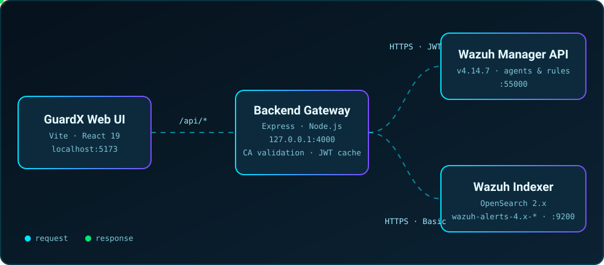

<div align="center">




[](https://wazuh.com/)
[](https://react.dev/)
[](https://vite.dev/)
[](https://nodejs.org/)
[](https://expressjs.com/)

[](https://github.com/yoga0061/GuardX/stargazers)
[](https://github.com/yoga0061/GuardX/network/members)
[](https://github.com/yoga0061/GuardX/issues)

**A Wazuh-based security monitoring dashboard for centralized visibility into alerts, endpoints, file integrity events and threat intelligence.**

[Quick start](#-quick-start) · [Features](#-key-capabilities) · [Architecture](#-architecture) · [Configuration](#-configuration) · [Security](#-security-notes)

</div>


## 🛡️ About GuardX

**GuardX** is a web-based Security Operations Center (SOC) dashboard built around **Wazuh**. It brings selected security telemetry and endpoint information into a single React interface, backed by a Node.js and Express API.

The backend acts as the integration layer between the browser and Wazuh Manager / Wazuh Indexer. Wazuh credentials and TLS configuration stay on the server side; the frontend communicates with the GuardX API rather than connecting directly to Wazuh.

> **No Wazuh lab available?** Use the Demo or Unconnected mode available in the dashboard to explore the interface without a live Wazuh connection.

## ✨ Key capabilities

| Module | What it provides |
|---|---|
| 🚨 Alerts | Browse and inspect security alerts collected from Wazuh |
| 🖥️ Endpoints | View registered Wazuh agents and endpoint status |
| 🗂️ File Integrity Monitoring | Review file-integrity events and related metadata |
| ⚡ PowerShell telemetry | Inspect PowerShell-related events available through indexed alert data |
| 📜 Detection rules | Explore Wazuh detection-rule information |
| 🧠 Threat intelligence | Review correlated security events and AI-assisted analysis when configured |
| 📦 Application inventory | Review software inventory and change-history information where available |
| 🎛️ Operating modes | Use Live, Demo or Unconnected mode where supported by the current configuration |

Feature availability depends on collected Wazuh data, enabled integrations and backend configuration.

## ⚡ Quick start

### Prerequisites

- Node.js and npm (a current supported Node.js LTS release).
- Wazuh Manager and Wazuh Indexer for Live mode.
- Network access from the backend host to the configured Wazuh services.
- The appropriate Wazuh CA certificate for strict TLS verification.

### 1. Clone the repository

```bash
git clone https://github.com/yoga0061/GuardX.git
cd GuardX
```

### 2. Install dependencies

```bash
npm install
npm install --prefix backend
```

### 3. Create local environment files

**Windows PowerShell:**
```powershell
Copy-Item .env.example .env
Copy-Item backend/.env.example backend/.env
```

**Git Bash / macOS / Linux:**
```bash
cp .env.example .env
cp backend/.env.example backend/.env
```

Edit the files with your own lab configuration. Never commit these files.

### 4. Start the backend

Open Terminal 1:

```bash
npm run dev --prefix backend
```

The example backend configuration uses `127.0.0.1:4000`.

### 5. Start the frontend

Open Terminal 2 from the project root:

```bash
npm run dev
```

Open the local URL printed by Vite, normally `http://localhost:5173`.


## 🏛️ Architecture

GuardX separates the browser interface from the Wazuh integration layer. The browser calls the GuardX API; the backend communicates with Wazuh Manager and Wazuh Indexer.

<div align="center">

</div>

<details>
<summary><strong>View architecture as text</strong></summary>

```text
GuardX Web UI (React + Vite)
          |
          | /api/*
          v
GuardX Backend (Node.js + Express)
          |
          +------ HTTPS ------> Wazuh Manager API
          |
          +------ HTTPS ------> Wazuh Indexer / OpenSearch
```
</details>

## 🧰 Technology stack


| Layer | Technologies |
|---|---|
| Frontend | React, React Router, Vite, Tailwind CSS, Recharts, Lucide React |
| Backend | Node.js, Express, Axios, dotenv |
| SIEM | Wazuh Manager, Wazuh Indexer / OpenSearch |
| AI integration | Google Gemini API (optional; configured on the backend) |
| Development | Git, GitHub, npm |

## 🎛️ Operating modes

| Mode | Description |
|---|---|
| **Live** | Retrieves telemetry through the GuardX backend, which connects to configured Wazuh services |
| **Demo** | Uses simulated data for demonstrations and interface exploration |
| **Unconnected** | Provides the disconnected/catalogue experience without a live Wazuh connection |

## ⚙️ Configuration

GuardX uses separate environment files for frontend and backend configuration.

### Frontend: `.env`

```ini
VITE_API_BASE_URL=/api
VITE_DATA_SOURCE=unconnected
VITE_ENVIRONMENT=LOCAL
VITE_WAZUH_VERSION=4.14.7
API_PROXY_TARGET=http://127.0.0.1:4000
```

Only variables prefixed with `VITE_` are exposed to frontend code. Never put passwords, tokens, private keys or API secrets in `VITE_` variables.

### Backend: `backend/.env`

Start with `backend/.env.example` and set values for your own lab:

```ini
PORT=4000
HOST=127.0.0.1
NODE_ENV=development
CORS_ORIGIN=http://127.0.0.1:5173,http://localhost:5173

WAZUH_API_URL=https://127.0.0.1:55000
WAZUH_API_USER=your_wazuh_api_user
WAZUH_API_PASSWORD=your_wazuh_api_password

WAZUH_INDEXER_URL=https://127.0.0.1:9200
WAZUH_INDEXER_USER=your_wazuh_indexer_user
WAZUH_INDEXER_PASSWORD=your_wazuh_indexer_password

WAZUH_CA_CERT_PATH=/path/to/your/wazuh-root-ca.pem
WAZUH_ALLOW_SELF_SIGNED=false

GEMINI_API_KEY=
GEMINI_MODEL=gemini-2.5-flash
```

Adjust URLs and certificate paths to match your environment. Keep TLS verification enabled and provide the correct CA certificate rather than disabling certificate checks.


## 🔌 Backend API

The Express backend route groups are organized under `backend/src/routes/`:

| Route group | Purpose |
|---|---|
| `/api/health` | Backend and integration health information |
| `/api/alerts` | Alert retrieval |
| `/api/endpoints` | Wazuh agent / endpoint information |
| `/api/applications` | Software inventory and change history |
| `/api/rules` | Detection-rule information |
| `/api/telemetry` | Security telemetry |
| `/api/threat-intel` | Threat-intelligence and correlated incident workflows |

For exact request parameters and response formats, inspect the corresponding route files in `backend/src/routes/`.

## 🧪 Build and code checks

From the project root:

```bash
npm run lint
npm run build
```

The frontend production output is generated in `dist/`. The backend is a separate Node.js service and must also be configured and deployed.

## 🔐 Security notes

- Never commit `.env`, `backend/.env`, passwords, API keys, private keys or CA private material.
- Keep Wazuh Manager and Indexer ports on a trusted private network. Do not expose them directly to the public internet.
- Keep Wazuh credentials and the Gemini API key on the backend only.
- Use strict TLS certificate validation and configure the correct CA certificate.
- Restrict backend CORS origins to the frontend origins you intend to trust.
- Treat alerts, endpoint names, IP addresses and raw event payloads as potentially sensitive. Redact them before sharing screenshots or logs.
- Demo data is simulated; do not interpret it as live security telemetry.

## 🗺️ Roadmap

Potential future improvements:

- [ ] Document a reproducible deployment for different environments
- [ ] Add role-based access control for dashboard users
- [ ] Add export options for selected reports and tables
- [ ] Expand automated tests for API routes and data normalization
- [ ] Add Docker Compose support for local development
- [ ] Improve responsive layouts and accessibility

## 🤝 Contributing

1. Fork the repository.
2. Create a feature branch: `git checkout -b feature/your-feature`
3. Make focused changes.
4. Run the available checks:

   ```bash
   npm run lint
   npm run build
   ```

5. Commit your changes and open a Pull Request with a clear description.

For security-sensitive issues, do not post credentials, raw telemetry or exploitable details in a public issue. Contact the repository maintainer privately.

## 👤 Maintainer

**Yoga** · [@yoga0061](https://github.com/yoga0061)

[GitHub repository](https://github.com/yoga0061/GuardX) · [Report an issue](https://github.com/yoga0061/GuardX/issues)

## 📄 License

No license file is currently included in this repository. Unless a license is added, the default copyright rules apply; do not assume the project is MIT-licensed.

<div align="center">

<sub>Built for security monitoring and learning with Wazuh.</sub>
</div>
